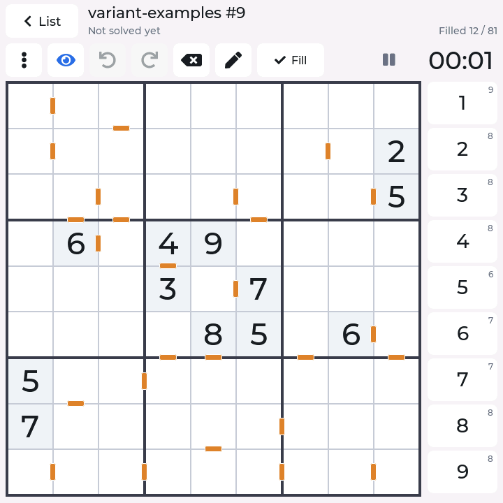
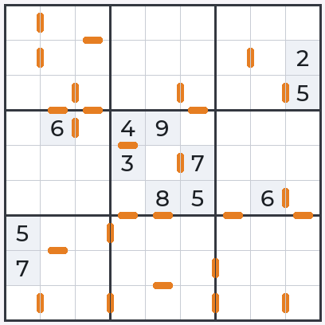

# Consecutive

[← All variants](README.md) · [Puzzles](../features-puzzles.md) · [How to play](../how-to-play.md)

## The rules

[Classic](classic.md) rules, and an orange **bar** sits on the line between every two side-by-side cells whose digits are **1 apart** (like 4 and 5). Every such pair has a bar, so **where there's no bar, the two digits are not 1 apart**. Cells that only touch at a corner don't count.

## On the board

- The bars are short orange marks across the line between two cells.
- Two digits that break the rule (a bar and not 1 apart, or 1 apart with no bar) turn red.
- The grader and hints use the bars: "The bars around row 4, column 2 (and where there are none) leave it only 3, 5".
- **Puzzles → ⋮ → New puzzle → Consecutive**. The bars carry most of the puzzle: Easy keeps about 14 givens, Expert as few as 2 to 4.

## How to solve it

- **A bar next to a digit** leaves two choices: next to a 6, the cell is 5 or 7. Next to a 1 or a 9, only one: 2 or 8.
- **No bar is information too.** A cell next to a 5 with no bar can't be 4 or 6. A cell with no bars at all around it, next to several filled cells, loses a lot of candidates.
- **Count the bars:** a 1 can only have a bar to a 2, and a row and a column each hold one 2, so a 1 (or a 9) has at most two bars. A cell with three or four bars is 2 to 8.
- In the worked example, both kinds show up: bars that leave two choices, and missing bars that rule a digit out.

## Worked example

**variant-examples #9**, Consecutive Easy (see [Classic](classic.md#worked-example-the-whole-puzzle) for how to import the examples; cells are written r*row*c*column*). The bars are in the screenshot.

**Step 1: r6c4, with no bar above it.** Row 6 has 8, 5 and 6; column 4 has 4 and 3; box 5 has 4, 9, 3, 7, 8 and 5. By the Classic rules r6c4 could be 1 or 2. But r5c4, right above it, is a 3, and there's **no bar** between them: so r6c4 isn't 2 (or 4). **r6c4 = 1**.

**Step 2: r6c9, with a bar to its left.** There's a **bar** between r6c8 (a 6) and r6c9, so r6c9 is 5 or 7. Row 6 already has a 5 (r6c6). **r6c9 = 7**.

**Step 3: the 5 in box 4.** Box 4 (rows 4–6, columns 1–3) needs a 5:

- r4c1, r5c1: column 1 has a 5 (r7c1).
- r6c1, r6c2, r6c3: row 6 has a 5 (r6c6).
- r4c3: its right-hand neighbour r4c4 is a 4, with **no bar**: r4c3 can't be 3 or 5.
- r5c2: the cell above it, r4c2, is a 6, with **no bar**: r5c2 can't be 5 or 7.

Only **r5c3** is left: **r5c3 = 5**.

While you're at r4c3: it has a **bar** to the 6 on its left (so it's 5 or 7) and no bar to the 4 on its right (so it's not 5): **r4c3 = 7**.

## The whole puzzle, step by step

<!-- walkthrough -->
<!-- Written by tools/walkthrough.py consecutive: edit the script, not this part. -->

The whole puzzle, from the start to the last cell: 69 steps, each one a single (one place left for a digit, or one digit left for a cell), taken in the order a box's single comes first, so not quite the order of the worked example above. Each step has a page of its own, with **Previous** and **Next**: pick one from the list below. In each picture, the unit the step looks at is tinted yellow (for a cell with one digit left: its row, column and box), the new digit is on green, the digits that rule cells out have an **orange ring**, and the empty cells they rule out a **red cross**. Givens are on grey, digits from earlier steps in blue.

1. [the 5 in box 4](consecutive/step-01.md)
2. [the 2 in box 5](consecutive/step-02.md)
3. [the 1 in box 5](consecutive/step-03.md)
4. [the 6 in box 5](consecutive/step-04.md)
5. [the 4 in row 6](consecutive/step-05.md)
6. [the 3 in box 4](consecutive/step-06.md)
7. [the 3 in box 6](consecutive/step-07.md)
8. [the 3 in box 3](consecutive/step-08.md)
9. [the 2 in box 6](consecutive/step-09.md)
10. [the 2 in box 4](consecutive/step-10.md)
11. [the 1 in box 4](consecutive/step-11.md)
12. [the 8 in box 4](consecutive/step-12.md)
13. [the 9 in box 4](consecutive/step-13.md)
14. [the 7 in box 4](consecutive/step-14.md)
15. [the 1 in box 6](consecutive/step-15.md)
16. [the 4 in box 6](consecutive/step-16.md)
17. [the 7 in box 6](consecutive/step-17.md)
18. [the 9 in box 6](consecutive/step-18.md)
19. [the 8 in box 6](consecutive/step-19.md)
20. [the 5 in box 6](consecutive/step-20.md)
21. [the 7 in row 7](consecutive/step-21.md)
22. [r3c2](consecutive/step-22.md)
23. [r3c8](consecutive/step-23.md)
24. [r7c4](consecutive/step-24.md)
25. [the 2 in row 3](consecutive/step-25.md)
26. [the 3 in row 3](consecutive/step-26.md)
27. [the 3 in row 7](consecutive/step-27.md)
28. [the 3 in box 1](consecutive/step-28.md)
29. [the 2 in box 1](consecutive/step-29.md)
30. [the 5 in box 1](consecutive/step-30.md)
31. [the 8 in box 1](consecutive/step-31.md)
32. [the 6 in box 1](consecutive/step-32.md)
33. [the 4 in box 1](consecutive/step-33.md)
34. [the 9 in box 1](consecutive/step-34.md)
35. [the 1 in box 1](consecutive/step-35.md)
36. [the 6 in box 3](consecutive/step-36.md)
37. [the 6 in box 2](consecutive/step-37.md)
38. [the 5 in box 2](consecutive/step-38.md)
39. [the 4 in box 2](consecutive/step-39.md)
40. [the 1 in box 2](consecutive/step-40.md)
41. [the 7 in box 2](consecutive/step-41.md)
42. [the 8 in box 2](consecutive/step-42.md)
43. [the 9 in box 2](consecutive/step-43.md)
44. [the 1 in box 3](consecutive/step-44.md)
45. [the 7 in box 3](consecutive/step-45.md)
46. [the 9 in box 3](consecutive/step-46.md)
47. [the 8 in box 3](consecutive/step-47.md)
48. [the 1 in box 7](consecutive/step-48.md)
49. [the 4 in box 7](consecutive/step-49.md)
50. [the 6 in box 7](consecutive/step-50.md)
51. [the 8 in box 7](consecutive/step-51.md)
52. [the 2 in box 7](consecutive/step-52.md)
53. [the 9 in box 7](consecutive/step-53.md)
54. [the 4 in box 8](consecutive/step-54.md)
55. [the 3 in box 8](consecutive/step-55.md)
56. [the 5 in box 8](consecutive/step-56.md)
57. [the 6 in box 8](consecutive/step-57.md)
58. [the 8 in box 8](consecutive/step-58.md)
59. [the 9 in box 8](consecutive/step-59.md)
60. [the 1 in box 8](consecutive/step-60.md)
61. [the 1 in box 9](consecutive/step-61.md)
62. [the 2 in box 9](consecutive/step-62.md)
63. [the 3 in box 9](consecutive/step-63.md)
64. [the 4 in box 9](consecutive/step-64.md)
65. [the 5 in box 9](consecutive/step-65.md)
66. [the 6 in box 9](consecutive/step-66.md)
67. [the 7 in box 9](consecutive/step-67.md)
68. [the 8 in box 9](consecutive/step-68.md)
69. [the 9 in box 9](consecutive/step-69.md)

Solved.

<!-- /walkthrough -->
