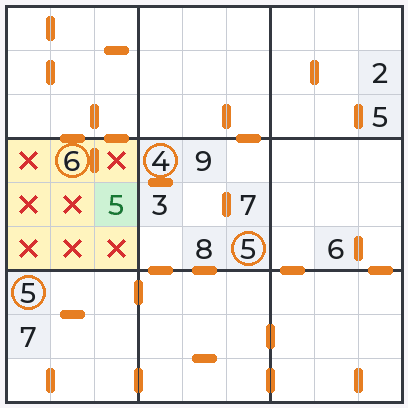

<!-- Written by tools/walkthrough.py consecutive: edit the script, not this page. -->
# Consecutive, step 1: the 5 in box 4

**Step 1 of 69** · [← The start](../consecutive.md#the-whole-puzzle-step-by-step) · [All steps](../consecutive.md#the-whole-puzzle-step-by-step) · [Step 2 →](step-02.md)

Box 4 needs a 5. r4c1 and r5c1: column 1 has one (r7c1). r6c1, r6c2 and r6c3: row 6 has one (r6c6). r4c3: it has no bar to the 4 in r4c4, so it isn't 3 or 5. r5c2: it has no bar to the 6 in r4c2, so it isn't 5 or 7. Only **r5c3** is left: **r5c3 = 5**.

**Step 1 of 69** · [← The start](../consecutive.md#the-whole-puzzle-step-by-step) · [All steps](../consecutive.md#the-whole-puzzle-step-by-step) · [Step 2 →](step-02.md)
