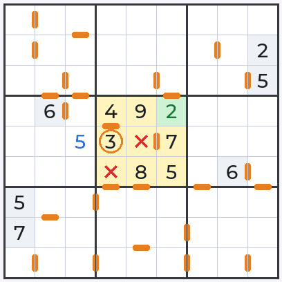

<!-- Written by tools/walkthrough.py consecutive: edit the script, not this page. -->
# Consecutive, step 2: the 2 in box 5

**Step 2 of 69** · [← Step 1](step-01.md) · [All steps](../consecutive.md#the-whole-puzzle-step-by-step) · [Step 3 →](step-03.md)

Box 5 needs a 2. r5c5 and r6c4: it has no bar to the 3 in r5c4, so it isn't 2 or 4. Only **r4c6** is left: **r4c6 = 2**.

**Step 2 of 69** · [← Step 1](step-01.md) · [All steps](../consecutive.md#the-whole-puzzle-step-by-step) · [Step 3 →](step-03.md)
