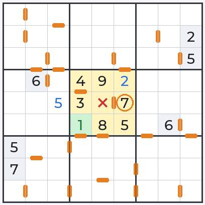

<!-- Written by tools/walkthrough.py consecutive: edit the script, not this page. -->
# Consecutive, step 3: the 1 in box 5

**Step 3 of 69** · [← Step 2](step-02.md) · [All steps](../consecutive.md#the-whole-puzzle-step-by-step) · [Step 4 →](step-04.md)

Box 5 needs a 1. r5c5: it has a bar to the 7 in r5c6, so it's 6 or 8. Only **r6c4** is left: **r6c4 = 1**.

**Step 3 of 69** · [← Step 2](step-02.md) · [All steps](../consecutive.md#the-whole-puzzle-step-by-step) · [Step 4 →](step-04.md)
