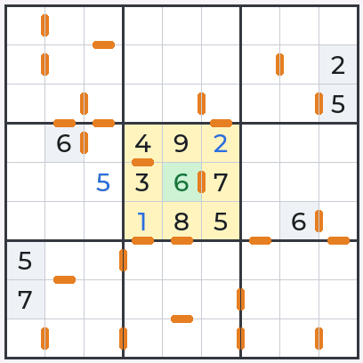

<!-- Written by tools/walkthrough.py consecutive: edit the script, not this page. -->
# Consecutive, step 4: the 6 in box 5

**Step 4 of 69** · [← Step 3](step-03.md) · [All steps](../consecutive.md#the-whole-puzzle-step-by-step) · [Step 5 →](step-05.md)

Box 5 needs a 6, and r5c5 is its last empty cell: **r5c5 = 6**.

**Step 4 of 69** · [← Step 3](step-03.md) · [All steps](../consecutive.md#the-whole-puzzle-step-by-step) · [Step 5 →](step-05.md)
