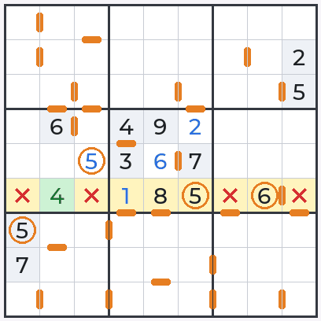

<!-- Written by tools/walkthrough.py consecutive: edit the script, not this page. -->
# Consecutive, step 5: the 4 in row 6

**Step 5 of 69** · [← Step 4](step-04.md) · [All steps](../consecutive.md#the-whole-puzzle-step-by-step) · [Step 6 →](step-06.md)

Row 6 needs a 4. r6c1: it has no bar to the 5 in r7c1, so it isn't 4 or 6. r6c3: it has no bar to the 5 in r5c3, so it isn't 4 or 6. r6c7: it has no bar to the 5 in r6c6, so it isn't 4 or 6. r6c9: it has a bar to the 6 in r6c8, so it's 5 or 7. Only **r6c2** is left: **r6c2 = 4**.

**Step 5 of 69** · [← Step 4](step-04.md) · [All steps](../consecutive.md#the-whole-puzzle-step-by-step) · [Step 6 →](step-06.md)
