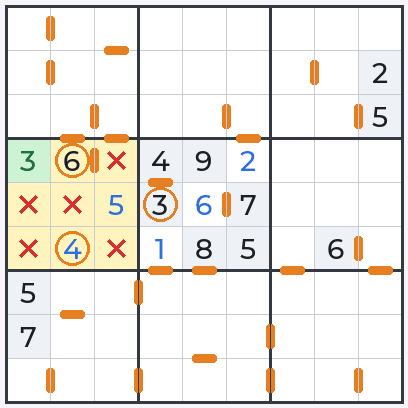

<!-- Written by tools/walkthrough.py consecutive: edit the script, not this page. -->
# Consecutive, step 6: the 3 in box 4

**Step 6 of 69** · [← Step 5](step-05.md) · [All steps](../consecutive.md#the-whole-puzzle-step-by-step) · [Step 7 →](step-07.md)

Box 4 needs a 3. r5c1 and r5c2: row 5 has one (r5c4). r4c3: it has a bar to the 6 in r4c2, so it's 5 or 7. r6c1 and r6c3: it has no bar to the 4 in r6c2, so it isn't 3 or 5. Only **r4c1** is left: **r4c1 = 3**.

**Step 6 of 69** · [← Step 5](step-05.md) · [All steps](../consecutive.md#the-whole-puzzle-step-by-step) · [Step 7 →](step-07.md)
