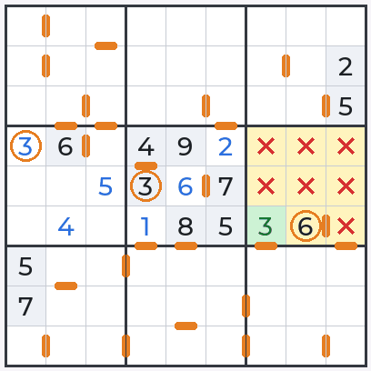

<!-- Written by tools/walkthrough.py consecutive: edit the script, not this page. -->
# Consecutive, step 7: the 3 in box 6

**Step 7 of 69** · [← Step 6](step-06.md) · [All steps](../consecutive.md#the-whole-puzzle-step-by-step) · [Step 8 →](step-08.md)

Box 6 needs a 3. r4c7, r4c8 and r4c9: row 4 has one (r4c1). r5c7, r5c8 and r5c9: row 5 has one (r5c4). r6c9: it has a bar to the 6 in r6c8, so it's 5 or 7. Only **r6c7** is left: **r6c7 = 3**.

**Step 7 of 69** · [← Step 6](step-06.md) · [All steps](../consecutive.md#the-whole-puzzle-step-by-step) · [Step 8 →](step-08.md)
