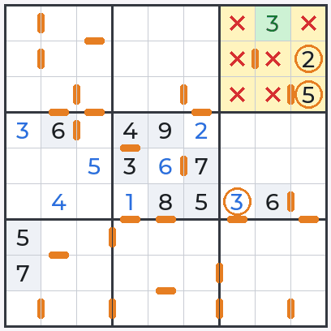

<!-- Written by tools/walkthrough.py consecutive: edit the script, not this page. -->
# Consecutive, step 8: the 3 in box 3

**Step 8 of 69** · [← Step 7](step-07.md) · [All steps](../consecutive.md#the-whole-puzzle-step-by-step) · [Step 9 →](step-09.md)

Box 3 needs a 3. r1c7, r2c7 and r3c7: column 7 has one (r6c7). r1c9 and r2c8: it has no bar to the 2 in r2c9, so it isn't 1 or 3. r3c8: it has a bar to the 5 in r3c9, so it's 4 or 6. Only **r1c8** is left: **r1c8 = 3**.

**Step 8 of 69** · [← Step 7](step-07.md) · [All steps](../consecutive.md#the-whole-puzzle-step-by-step) · [Step 9 →](step-09.md)
