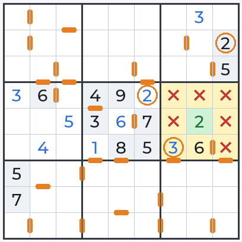

<!-- Written by tools/walkthrough.py consecutive: edit the script, not this page. -->
# Consecutive, step 9: the 2 in box 6

**Step 9 of 69** · [← Step 8](step-08.md) · [All steps](../consecutive.md#the-whole-puzzle-step-by-step) · [Step 10 →](step-10.md)

Box 6 needs a 2. r4c7, r4c8 and r4c9: row 4 has one (r4c6). r5c9 and r6c9: column 9 has one (r2c9). r5c7: it has no bar to the 3 in r6c7, so it isn't 2 or 4. Only **r5c8** is left: **r5c8 = 2**.

**Step 9 of 69** · [← Step 8](step-08.md) · [All steps](../consecutive.md#the-whole-puzzle-step-by-step) · [Step 10 →](step-10.md)
