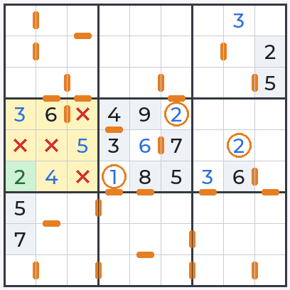

<!-- Written by tools/walkthrough.py consecutive: edit the script, not this page. -->
# Consecutive, step 10: the 2 in box 4

**Step 10 of 69** · [← Step 9](step-09.md) · [All steps](../consecutive.md#the-whole-puzzle-step-by-step) · [Step 11 →](step-11.md)

Box 4 needs a 2. r4c3: row 4 has one (r4c6). r5c1 and r5c2: row 5 has one (r5c8). r6c3: it has no bar to the 1 in r6c4, so it isn't 2. Only **r6c1** is left: **r6c1 = 2**.

**Step 10 of 69** · [← Step 9](step-09.md) · [All steps](../consecutive.md#the-whole-puzzle-step-by-step) · [Step 11 →](step-11.md)
