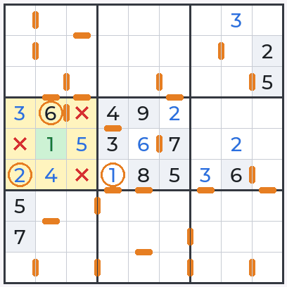

<!-- Written by tools/walkthrough.py consecutive: edit the script, not this page. -->
# Consecutive, step 11: the 1 in box 4

**Step 11 of 69** · [← Step 10](step-10.md) · [All steps](../consecutive.md#the-whole-puzzle-step-by-step) · [Step 12 →](step-12.md)

Box 4 needs a 1. r6c3: row 6 has one (r6c4). r4c3: it has a bar to the 6 in r4c2, so it's 5 or 7. r5c1: it has no bar to the 2 in r6c1, so it isn't 1 or 3. Only **r5c2** is left: **r5c2 = 1**.

**Step 11 of 69** · [← Step 10](step-10.md) · [All steps](../consecutive.md#the-whole-puzzle-step-by-step) · [Step 12 →](step-12.md)
