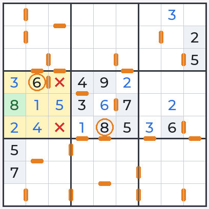

<!-- Written by tools/walkthrough.py consecutive: edit the script, not this page. -->
# Consecutive, step 12: the 8 in box 4

**Step 12 of 69** · [← Step 11](step-11.md) · [All steps](../consecutive.md#the-whole-puzzle-step-by-step) · [Step 13 →](step-13.md)

Box 4 needs an 8. r6c3: row 6 has one (r6c5). r4c3: it has a bar to the 6 in r4c2, so it's 5 or 7. Only **r5c1** is left: **r5c1 = 8**.

**Step 12 of 69** · [← Step 11](step-11.md) · [All steps](../consecutive.md#the-whole-puzzle-step-by-step) · [Step 13 →](step-13.md)
