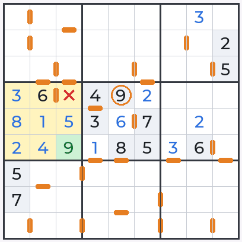

<!-- Written by tools/walkthrough.py consecutive: edit the script, not this page. -->
# Consecutive, step 13: the 9 in box 4

**Step 13 of 69** · [← Step 12](step-12.md) · [All steps](../consecutive.md#the-whole-puzzle-step-by-step) · [Step 14 →](step-14.md)

Box 4 needs a 9. r4c3: row 4 has one (r4c5). Only **r6c3** is left: **r6c3 = 9**.

**Step 13 of 69** · [← Step 12](step-12.md) · [All steps](../consecutive.md#the-whole-puzzle-step-by-step) · [Step 14 →](step-14.md)
