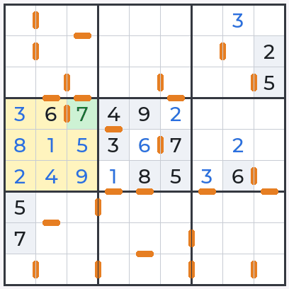

<!-- Written by tools/walkthrough.py consecutive: edit the script, not this page. -->
# Consecutive, step 14: the 7 in box 4

**Step 14 of 69** · [← Step 13](step-13.md) · [All steps](../consecutive.md#the-whole-puzzle-step-by-step) · [Step 15 →](step-15.md)

Box 4 needs a 7, and r4c3 is its last empty cell: **r4c3 = 7**.

**Step 14 of 69** · [← Step 13](step-13.md) · [All steps](../consecutive.md#the-whole-puzzle-step-by-step) · [Step 15 →](step-15.md)
