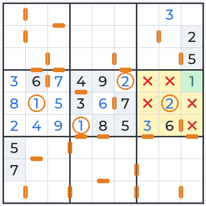

<!-- Written by tools/walkthrough.py consecutive: edit the script, not this page. -->
# Consecutive, step 15: the 1 in box 6

**Step 15 of 69** · [← Step 14](step-14.md) · [All steps](../consecutive.md#the-whole-puzzle-step-by-step) · [Step 16 →](step-16.md)

Box 6 needs a 1. r5c7 and r5c9: row 5 has one (r5c2). r6c9: row 6 has one (r6c4). r4c7: it has no bar to the 2 in r4c6, so it isn't 1 or 3. r4c8: it has no bar to the 2 in r5c8, so it isn't 1 or 3. Only **r4c9** is left: **r4c9 = 1**.

**Step 15 of 69** · [← Step 14](step-14.md) · [All steps](../consecutive.md#the-whole-puzzle-step-by-step) · [Step 16 →](step-16.md)
