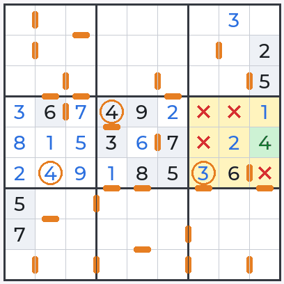

<!-- Written by tools/walkthrough.py consecutive: edit the script, not this page. -->
# Consecutive, step 16: the 4 in box 6

**Step 16 of 69** · [← Step 15](step-15.md) · [All steps](../consecutive.md#the-whole-puzzle-step-by-step) · [Step 17 →](step-17.md)

Box 6 needs a 4. r4c7 and r4c8: row 4 has one (r4c4). r6c9: row 6 has one (r6c2). r5c7: it has no bar to the 3 in r6c7, so it isn't 2 or 4. Only **r5c9** is left: **r5c9 = 4**.

**Step 16 of 69** · [← Step 15](step-15.md) · [All steps](../consecutive.md#the-whole-puzzle-step-by-step) · [Step 17 →](step-17.md)
