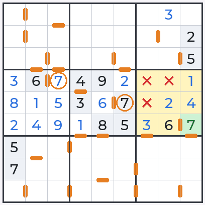

<!-- Written by tools/walkthrough.py consecutive: edit the script, not this page. -->
# Consecutive, step 17: the 7 in box 6

**Step 17 of 69** · [← Step 16](step-16.md) · [All steps](../consecutive.md#the-whole-puzzle-step-by-step) · [Step 18 →](step-18.md)

Box 6 needs a 7. r4c7 and r4c8: row 4 has one (r4c3). r5c7: row 5 has one (r5c6). Only **r6c9** is left: **r6c9 = 7**.

**Step 17 of 69** · [← Step 16](step-16.md) · [All steps](../consecutive.md#the-whole-puzzle-step-by-step) · [Step 18 →](step-18.md)
