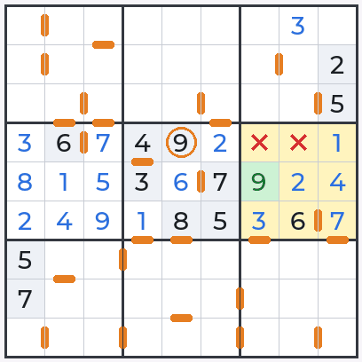

<!-- Written by tools/walkthrough.py consecutive: edit the script, not this page. -->
# Consecutive, step 18: the 9 in box 6

**Step 18 of 69** · [← Step 17](step-17.md) · [All steps](../consecutive.md#the-whole-puzzle-step-by-step) · [Step 19 →](step-19.md)

Box 6 needs a 9. r4c7 and r4c8: row 4 has one (r4c5). Only **r5c7** is left: **r5c7 = 9**.

**Step 18 of 69** · [← Step 17](step-17.md) · [All steps](../consecutive.md#the-whole-puzzle-step-by-step) · [Step 19 →](step-19.md)
