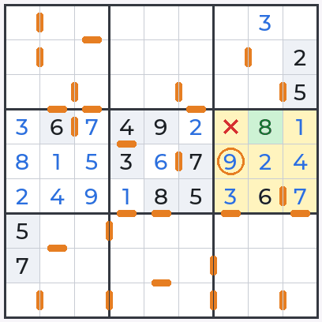

<!-- Written by tools/walkthrough.py consecutive: edit the script, not this page. -->
# Consecutive, step 19: the 8 in box 6

**Step 19 of 69** · [← Step 18](step-18.md) · [All steps](../consecutive.md#the-whole-puzzle-step-by-step) · [Step 20 →](step-20.md)

Box 6 needs an 8. r4c7: it has no bar to the 9 in r5c7, so it isn't 8. Only **r4c8** is left: **r4c8 = 8**.

**Step 19 of 69** · [← Step 18](step-18.md) · [All steps](../consecutive.md#the-whole-puzzle-step-by-step) · [Step 20 →](step-20.md)
