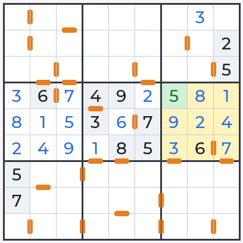

<!-- Written by tools/walkthrough.py consecutive: edit the script, not this page. -->
# Consecutive, step 20: the 5 in box 6

**Step 20 of 69** · [← Step 19](step-19.md) · [All steps](../consecutive.md#the-whole-puzzle-step-by-step) · [Step 21 →](step-21.md)

Box 6 needs a 5, and r4c7 is its last empty cell: **r4c7 = 5**.

**Step 20 of 69** · [← Step 19](step-19.md) · [All steps](../consecutive.md#the-whole-puzzle-step-by-step) · [Step 21 →](step-21.md)
