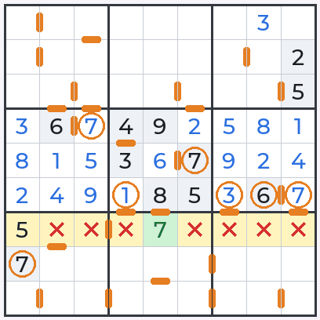

<!-- Written by tools/walkthrough.py consecutive: edit the script, not this page. -->
# Consecutive, step 21: the 7 in row 7

**Step 21 of 69** · [← Step 20](step-20.md) · [All steps](../consecutive.md#the-whole-puzzle-step-by-step) · [Step 22 →](step-22.md)

Row 7 needs a 7. r7c2: box 7 has one (r8c1). r7c3: column 3 has one (r4c3). r7c6: column 6 has one (r5c6). r7c9: column 9 has one (r6c9). r7c4: it has a bar to the 1 in r6c4, so it's 2. r7c7: it has a bar to the 3 in r6c7, so it's 2 or 4. r7c8: it has no bar to the 6 in r6c8, so it isn't 5 or 7. Only **r7c5** is left: **r7c5 = 7**.

**Step 21 of 69** · [← Step 20](step-20.md) · [All steps](../consecutive.md#the-whole-puzzle-step-by-step) · [Step 22 →](step-22.md)
