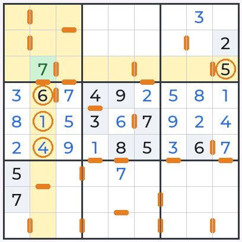

<!-- Written by tools/walkthrough.py consecutive: edit the script, not this page. -->
# Consecutive, step 22: r3c2

**Step 22 of 69** · [← Step 21](step-21.md) · [All steps](../consecutive.md#the-whole-puzzle-step-by-step) · [Step 23 →](step-23.md)

Column 2 has 1, 4 and 6; row 3 has 5. Not 2, 3, 8 or 9: it has a bar to the 6 in r4c2, so it's 5 or 7. Only 7 is left: **r3c2 = 7**.

**Step 22 of 69** · [← Step 21](step-21.md) · [All steps](../consecutive.md#the-whole-puzzle-step-by-step) · [Step 23 →](step-23.md)
