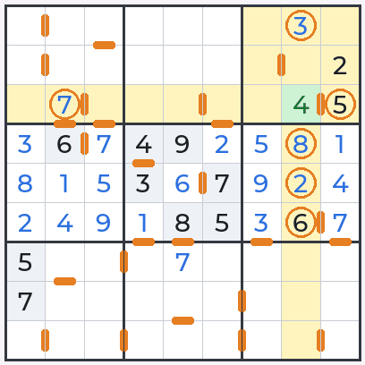

<!-- Written by tools/walkthrough.py consecutive: edit the script, not this page. -->
# Consecutive, step 23: r3c8

**Step 23 of 69** · [← Step 22](step-22.md) · [All steps](../consecutive.md#the-whole-puzzle-step-by-step) · [Step 24 →](step-24.md)

Column 8 has 2, 3, 6 and 8; row 3 has 5 and 7. Not 1 or 9: it has a bar to the 5 in r3c9, so it's 4 or 6. Only 4 is left: **r3c8 = 4**.

**Step 23 of 69** · [← Step 22](step-22.md) · [All steps](../consecutive.md#the-whole-puzzle-step-by-step) · [Step 24 →](step-24.md)
