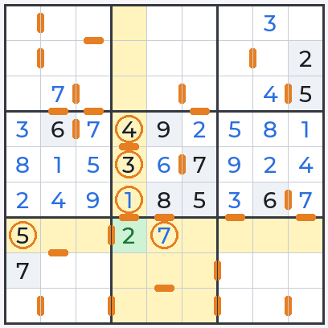

<!-- Written by tools/walkthrough.py consecutive: edit the script, not this page. -->
# Consecutive, step 24: r7c4

**Step 24 of 69** · [← Step 23](step-23.md) · [All steps](../consecutive.md#the-whole-puzzle-step-by-step) · [Step 25 →](step-25.md)

Column 4 has 1, 3 and 4; row 7 has 5 and 7. Not 6 or 8: it has no bar to the 7 in r7c5, so it isn't 6 or 8. Not 9: it has a bar to the 1 in r6c4, so it's 2. Only 2 is left: **r7c4 = 2**.

**Step 24 of 69** · [← Step 23](step-23.md) · [All steps](../consecutive.md#the-whole-puzzle-step-by-step) · [Step 25 →](step-25.md)
