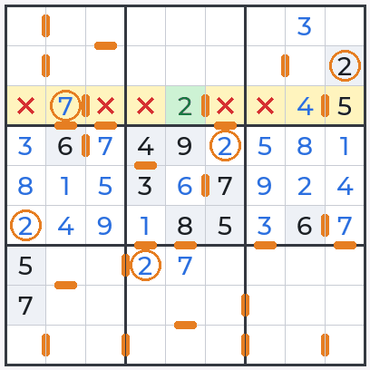

<!-- Written by tools/walkthrough.py consecutive: edit the script, not this page. -->
# Consecutive, step 25: the 2 in row 3

**Step 25 of 69** · [← Step 24](step-24.md) · [All steps](../consecutive.md#the-whole-puzzle-step-by-step) · [Step 26 →](step-26.md)

Row 3 needs a 2. r3c1: column 1 has one (r6c1). r3c4: column 4 has one (r7c4). r3c6: column 6 has one (r4c6). r3c7: box 3 has one (r2c9). r3c3: it has a bar to the 7 in r3c2, so it's 6 or 8. Only **r3c5** is left: **r3c5 = 2**.

**Step 25 of 69** · [← Step 24](step-24.md) · [All steps](../consecutive.md#the-whole-puzzle-step-by-step) · [Step 26 →](step-26.md)
