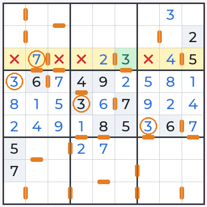

<!-- Written by tools/walkthrough.py consecutive: edit the script, not this page. -->
# Consecutive, step 26: the 3 in row 3

**Step 26 of 69** · [← Step 25](step-25.md) · [All steps](../consecutive.md#the-whole-puzzle-step-by-step) · [Step 27 →](step-27.md)

Row 3 needs a 3. r3c1: column 1 has one (r4c1). r3c4: column 4 has one (r5c4). r3c7: column 7 has one (r6c7). r3c3: it has a bar to the 7 in r3c2, so it's 6 or 8. Only **r3c6** is left: **r3c6 = 3**.

**Step 26 of 69** · [← Step 25](step-25.md) · [All steps](../consecutive.md#the-whole-puzzle-step-by-step) · [Step 27 →](step-27.md)
