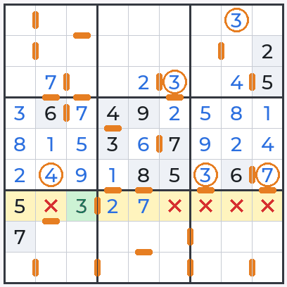

<!-- Written by tools/walkthrough.py consecutive: edit the script, not this page. -->
# Consecutive, step 27: the 3 in row 7

**Step 27 of 69** · [← Step 26](step-26.md) · [All steps](../consecutive.md#the-whole-puzzle-step-by-step) · [Step 28 →](step-28.md)

Row 7 needs a 3. r7c6: column 6 has one (r3c6). r7c7: column 7 has one (r6c7). r7c8: column 8 has one (r1c8). r7c2: it has no bar to the 4 in r6c2, so it isn't 3 or 5. r7c9: it has a bar to the 7 in r6c9, so it's 6 or 8. Only **r7c3** is left: **r7c3 = 3**.

**Step 27 of 69** · [← Step 26](step-26.md) · [All steps](../consecutive.md#the-whole-puzzle-step-by-step) · [Step 28 →](step-28.md)
