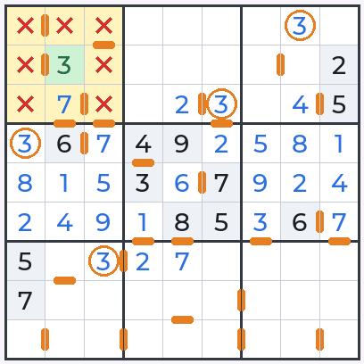

<!-- Written by tools/walkthrough.py consecutive: edit the script, not this page. -->
# Consecutive, step 28: the 3 in box 1

**Step 28 of 69** · [← Step 27](step-27.md) · [All steps](../consecutive.md#the-whole-puzzle-step-by-step) · [Step 29 →](step-29.md)

Box 1 needs a 3. r1c1, r1c2 and r1c3: row 1 has one (r1c8). r2c1: column 1 has one (r4c1). r2c3: column 3 has one (r7c3). r3c1 and r3c3: row 3 has one (r3c6). Only **r2c2** is left: **r2c2 = 3**.

**Step 28 of 69** · [← Step 27](step-27.md) · [All steps](../consecutive.md#the-whole-puzzle-step-by-step) · [Step 29 →](step-29.md)
