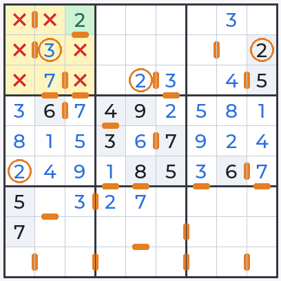

<!-- Written by tools/walkthrough.py consecutive: edit the script, not this page. -->
# Consecutive, step 29: the 2 in box 1

**Step 29 of 69** · [← Step 28](step-28.md) · [All steps](../consecutive.md#the-whole-puzzle-step-by-step) · [Step 30 →](step-30.md)

Box 1 needs a 2. r1c1: column 1 has one (r6c1). r2c1 and r2c3: row 2 has one (r2c9). r3c1 and r3c3: row 3 has one (r3c5). r1c2: it has no bar to the 3 in r2c2, so it isn't 2 or 4. Only **r1c3** is left: **r1c3 = 2**.

**Step 29 of 69** · [← Step 28](step-28.md) · [All steps](../consecutive.md#the-whole-puzzle-step-by-step) · [Step 30 →](step-30.md)
