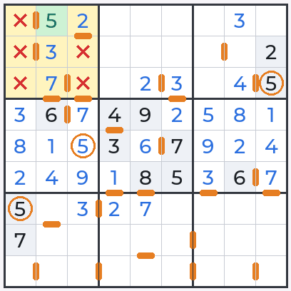

<!-- Written by tools/walkthrough.py consecutive: edit the script, not this page. -->
# Consecutive, step 30: the 5 in box 1

**Step 30 of 69** · [← Step 29](step-29.md) · [All steps](../consecutive.md#the-whole-puzzle-step-by-step) · [Step 31 →](step-31.md)

Box 1 needs a 5. r1c1 and r2c1: column 1 has one (r7c1). r2c3: column 3 has one (r5c3). r3c1 and r3c3: row 3 has one (r3c9). Only **r1c2** is left: **r1c2 = 5**.

**Step 30 of 69** · [← Step 29](step-29.md) · [All steps](../consecutive.md#the-whole-puzzle-step-by-step) · [Step 31 →](step-31.md)
