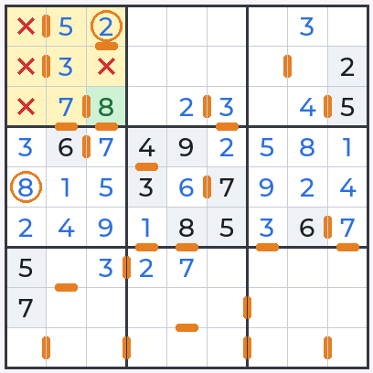

<!-- Written by tools/walkthrough.py consecutive: edit the script, not this page. -->
# Consecutive, step 31: the 8 in box 1

**Step 31 of 69** · [← Step 30](step-30.md) · [All steps](../consecutive.md#the-whole-puzzle-step-by-step) · [Step 32 →](step-32.md)

Box 1 needs an 8. r1c1, r2c1 and r3c1: column 1 has one (r5c1). r2c3: it has a bar to the 2 in r1c3, so it's 1 or 3. Only **r3c3** is left: **r3c3 = 8**.

**Step 31 of 69** · [← Step 30](step-30.md) · [All steps](../consecutive.md#the-whole-puzzle-step-by-step) · [Step 32 →](step-32.md)
