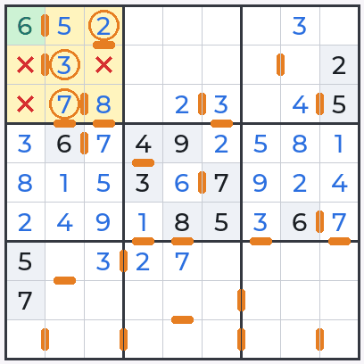

<!-- Written by tools/walkthrough.py consecutive: edit the script, not this page. -->
# Consecutive, step 32: the 6 in box 1

**Step 32 of 69** · [← Step 31](step-31.md) · [All steps](../consecutive.md#the-whole-puzzle-step-by-step) · [Step 33 →](step-33.md)

Box 1 needs a 6. r2c1: it has a bar to the 3 in r2c2, so it's 2 or 4. r2c3: it has a bar to the 2 in r1c3, so it's 1 or 3. r3c1: it has no bar to the 7 in r3c2, so it isn't 6 or 8. Only **r1c1** is left: **r1c1 = 6**.

**Step 32 of 69** · [← Step 31](step-31.md) · [All steps](../consecutive.md#the-whole-puzzle-step-by-step) · [Step 33 →](step-33.md)
