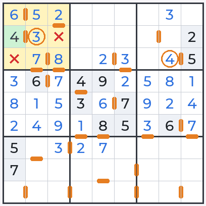

<!-- Written by tools/walkthrough.py consecutive: edit the script, not this page. -->
# Consecutive, step 33: the 4 in box 1

**Step 33 of 69** · [← Step 32](step-32.md) · [All steps](../consecutive.md#the-whole-puzzle-step-by-step) · [Step 34 →](step-34.md)

Box 1 needs a 4. r3c1: row 3 has one (r3c8). r2c3: it has no bar to the 3 in r2c2, so it isn't 2 or 4. Only **r2c1** is left: **r2c1 = 4**.

**Step 33 of 69** · [← Step 32](step-32.md) · [All steps](../consecutive.md#the-whole-puzzle-step-by-step) · [Step 34 →](step-34.md)
