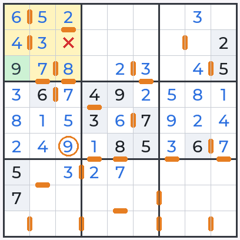

<!-- Written by tools/walkthrough.py consecutive: edit the script, not this page. -->
# Consecutive, step 34: the 9 in box 1

**Step 34 of 69** · [← Step 33](step-33.md) · [All steps](../consecutive.md#the-whole-puzzle-step-by-step) · [Step 35 →](step-35.md)

Box 1 needs a 9. r2c3: column 3 has one (r6c3). Only **r3c1** is left: **r3c1 = 9**.

**Step 34 of 69** · [← Step 33](step-33.md) · [All steps](../consecutive.md#the-whole-puzzle-step-by-step) · [Step 35 →](step-35.md)
