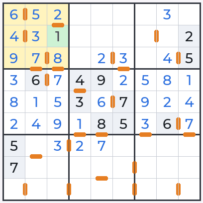

<!-- Written by tools/walkthrough.py consecutive: edit the script, not this page. -->
# Consecutive, step 35: the 1 in box 1

**Step 35 of 69** · [← Step 34](step-34.md) · [All steps](../consecutive.md#the-whole-puzzle-step-by-step) · [Step 36 →](step-36.md)

Box 1 needs a 1, and r2c3 is its last empty cell: **r2c3 = 1**.

**Step 35 of 69** · [← Step 34](step-34.md) · [All steps](../consecutive.md#the-whole-puzzle-step-by-step) · [Step 36 →](step-36.md)
