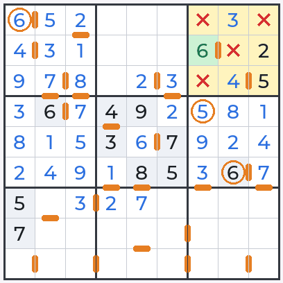

<!-- Written by tools/walkthrough.py consecutive: edit the script, not this page. -->
# Consecutive, step 36: the 6 in box 3

**Step 36 of 69** · [← Step 35](step-35.md) · [All steps](../consecutive.md#the-whole-puzzle-step-by-step) · [Step 37 →](step-37.md)

Box 3 needs a 6. r1c7 and r1c9: row 1 has one (r1c1). r2c8: column 8 has one (r6c8). r3c7: it has no bar to the 5 in r4c7, so it isn't 4 or 6. Only **r2c7** is left: **r2c7 = 6**.

**Step 36 of 69** · [← Step 35](step-35.md) · [All steps](../consecutive.md#the-whole-puzzle-step-by-step) · [Step 37 →](step-37.md)
