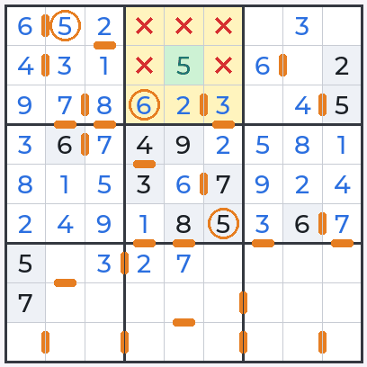

<!-- Written by tools/walkthrough.py consecutive: edit the script, not this page. -->
# Consecutive, step 38: the 5 in box 2

**Step 38 of 69** · [← Step 37](step-37.md) · [All steps](../consecutive.md#the-whole-puzzle-step-by-step) · [Step 39 →](step-39.md)

Box 2 needs a 5. r1c4, r1c5 and r1c6: row 1 has one (r1c2). r2c6: column 6 has one (r6c6). r2c4: it has no bar to the 6 in r3c4, so it isn't 5 or 7. Only **r2c5** is left: **r2c5 = 5**.

**Step 38 of 69** · [← Step 37](step-37.md) · [All steps](../consecutive.md#the-whole-puzzle-step-by-step) · [Step 39 →](step-39.md)
