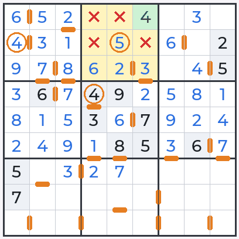

<!-- Written by tools/walkthrough.py consecutive: edit the script, not this page. -->
# Consecutive, step 39: the 4 in box 2

**Step 39 of 69** · [← Step 38](step-38.md) · [All steps](../consecutive.md#the-whole-puzzle-step-by-step) · [Step 40 →](step-40.md)

Box 2 needs a 4. r1c4: column 4 has one (r4c4). r2c4 and r2c6: row 2 has one (r2c1). r1c5: it has no bar to the 5 in r2c5, so it isn't 4 or 6. Only **r1c6** is left: **r1c6 = 4**.

**Step 39 of 69** · [← Step 38](step-38.md) · [All steps](../consecutive.md#the-whole-puzzle-step-by-step) · [Step 40 →](step-40.md)
