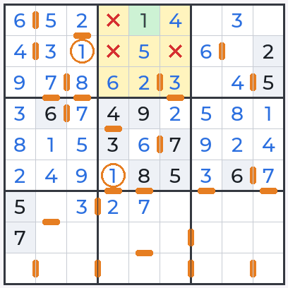

<!-- Written by tools/walkthrough.py consecutive: edit the script, not this page. -->
# Consecutive, step 40: the 1 in box 2

**Step 40 of 69** · [← Step 39](step-39.md) · [All steps](../consecutive.md#the-whole-puzzle-step-by-step) · [Step 41 →](step-41.md)

Box 2 needs a 1. r1c4: column 4 has one (r6c4). r2c4 and r2c6: row 2 has one (r2c3). Only **r1c5** is left: **r1c5 = 1**.

**Step 40 of 69** · [← Step 39](step-39.md) · [All steps](../consecutive.md#the-whole-puzzle-step-by-step) · [Step 41 →](step-41.md)
