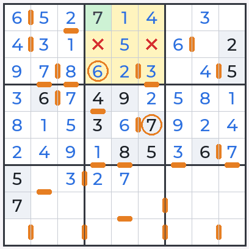

<!-- Written by tools/walkthrough.py consecutive: edit the script, not this page. -->
# Consecutive, step 41: the 7 in box 2

**Step 41 of 69** · [← Step 40](step-40.md) · [All steps](../consecutive.md#the-whole-puzzle-step-by-step) · [Step 42 →](step-42.md)

Box 2 needs a 7. r2c6: column 6 has one (r5c6). r2c4: it has no bar to the 6 in r3c4, so it isn't 5 or 7. Only **r1c4** is left: **r1c4 = 7**.

**Step 41 of 69** · [← Step 40](step-40.md) · [All steps](../consecutive.md#the-whole-puzzle-step-by-step) · [Step 42 →](step-42.md)
