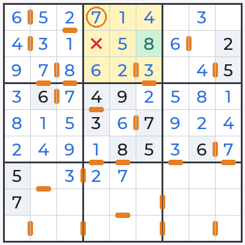

<!-- Written by tools/walkthrough.py consecutive: edit the script, not this page. -->
# Consecutive, step 42: the 8 in box 2

**Step 42 of 69** · [← Step 41](step-41.md) · [All steps](../consecutive.md#the-whole-puzzle-step-by-step) · [Step 43 →](step-43.md)

Box 2 needs an 8. r2c4: it has no bar to the 7 in r1c4, so it isn't 6 or 8. Only **r2c6** is left: **r2c6 = 8**.

**Step 42 of 69** · [← Step 41](step-41.md) · [All steps](../consecutive.md#the-whole-puzzle-step-by-step) · [Step 43 →](step-43.md)
