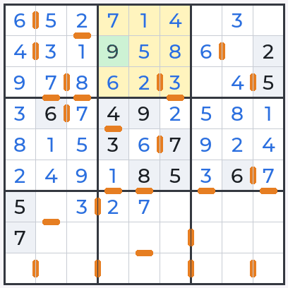

<!-- Written by tools/walkthrough.py consecutive: edit the script, not this page. -->
# Consecutive, step 43: the 9 in box 2

**Step 43 of 69** · [← Step 42](step-42.md) · [All steps](../consecutive.md#the-whole-puzzle-step-by-step) · [Step 44 →](step-44.md)

Box 2 needs a 9, and r2c4 is its last empty cell: **r2c4 = 9**.

**Step 43 of 69** · [← Step 42](step-42.md) · [All steps](../consecutive.md#the-whole-puzzle-step-by-step) · [Step 44 →](step-44.md)
