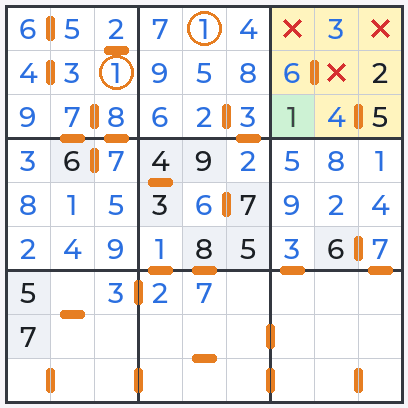

<!-- Written by tools/walkthrough.py consecutive: edit the script, not this page. -->
# Consecutive, step 44: the 1 in box 3

**Step 44 of 69** · [← Step 43](step-43.md) · [All steps](../consecutive.md#the-whole-puzzle-step-by-step) · [Step 45 →](step-45.md)

Box 3 needs a 1. r1c7 and r1c9: row 1 has one (r1c5). r2c8: row 2 has one (r2c3). Only **r3c7** is left: **r3c7 = 1**.

**Step 44 of 69** · [← Step 43](step-43.md) · [All steps](../consecutive.md#the-whole-puzzle-step-by-step) · [Step 45 →](step-45.md)
