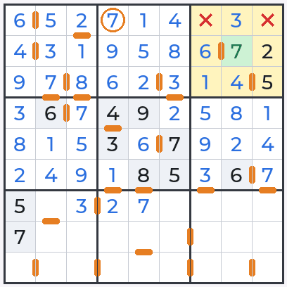

<!-- Written by tools/walkthrough.py consecutive: edit the script, not this page. -->
# Consecutive, step 45: the 7 in box 3

**Step 45 of 69** · [← Step 44](step-44.md) · [All steps](../consecutive.md#the-whole-puzzle-step-by-step) · [Step 46 →](step-46.md)

Box 3 needs a 7. r1c7 and r1c9: row 1 has one (r1c4). Only **r2c8** is left: **r2c8 = 7**.

**Step 45 of 69** · [← Step 44](step-44.md) · [All steps](../consecutive.md#the-whole-puzzle-step-by-step) · [Step 46 →](step-46.md)
