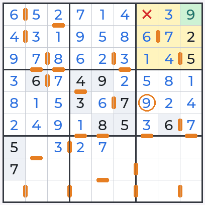

<!-- Written by tools/walkthrough.py consecutive: edit the script, not this page. -->
# Consecutive, step 46: the 9 in box 3

**Step 46 of 69** · [← Step 45](step-45.md) · [All steps](../consecutive.md#the-whole-puzzle-step-by-step) · [Step 47 →](step-47.md)

Box 3 needs a 9. r1c7: column 7 has one (r5c7). Only **r1c9** is left: **r1c9 = 9**.

**Step 46 of 69** · [← Step 45](step-45.md) · [All steps](../consecutive.md#the-whole-puzzle-step-by-step) · [Step 47 →](step-47.md)
