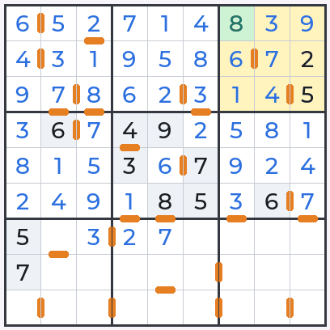

<!-- Written by tools/walkthrough.py consecutive: edit the script, not this page. -->
# Consecutive, step 47: the 8 in box 3

**Step 47 of 69** · [← Step 46](step-46.md) · [All steps](../consecutive.md#the-whole-puzzle-step-by-step) · [Step 48 →](step-48.md)

Box 3 needs an 8, and r1c7 is its last empty cell: **r1c7 = 8**.

**Step 47 of 69** · [← Step 46](step-46.md) · [All steps](../consecutive.md#the-whole-puzzle-step-by-step) · [Step 48 →](step-48.md)
