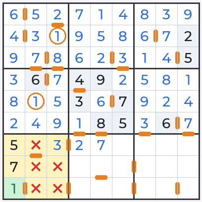

<!-- Written by tools/walkthrough.py consecutive: edit the script, not this page. -->
# Consecutive, step 48: the 1 in box 7

**Step 48 of 69** · [← Step 47](step-47.md) · [All steps](../consecutive.md#the-whole-puzzle-step-by-step) · [Step 49 →](step-49.md)

Box 7 needs a 1. r7c2, r8c2 and r9c2: column 2 has one (r5c2). r8c3 and r9c3: column 3 has one (r2c3). Only **r9c1** is left: **r9c1 = 1**.

**Step 48 of 69** · [← Step 47](step-47.md) · [All steps](../consecutive.md#the-whole-puzzle-step-by-step) · [Step 49 →](step-49.md)
