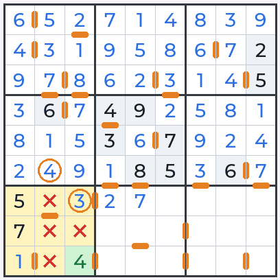

<!-- Written by tools/walkthrough.py consecutive: edit the script, not this page. -->
# Consecutive, step 49: the 4 in box 7

**Step 49 of 69** · [← Step 48](step-48.md) · [All steps](../consecutive.md#the-whole-puzzle-step-by-step) · [Step 50 →](step-50.md)

Box 7 needs a 4. r7c2, r8c2 and r9c2: column 2 has one (r6c2). r8c3: it has no bar to the 3 in r7c3, so it isn't 2 or 4. Only **r9c3** is left: **r9c3 = 4**.

**Step 49 of 69** · [← Step 48](step-48.md) · [All steps](../consecutive.md#the-whole-puzzle-step-by-step) · [Step 50 →](step-50.md)
