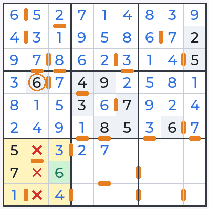

<!-- Written by tools/walkthrough.py consecutive: edit the script, not this page. -->
# Consecutive, step 50: the 6 in box 7

**Step 50 of 69** · [← Step 49](step-49.md) · [All steps](../consecutive.md#the-whole-puzzle-step-by-step) · [Step 51 →](step-51.md)

Box 7 needs a 6. r7c2, r8c2 and r9c2: column 2 has one (r4c2). Only **r8c3** is left: **r8c3 = 6**.

**Step 50 of 69** · [← Step 49](step-49.md) · [All steps](../consecutive.md#the-whole-puzzle-step-by-step) · [Step 51 →](step-51.md)
